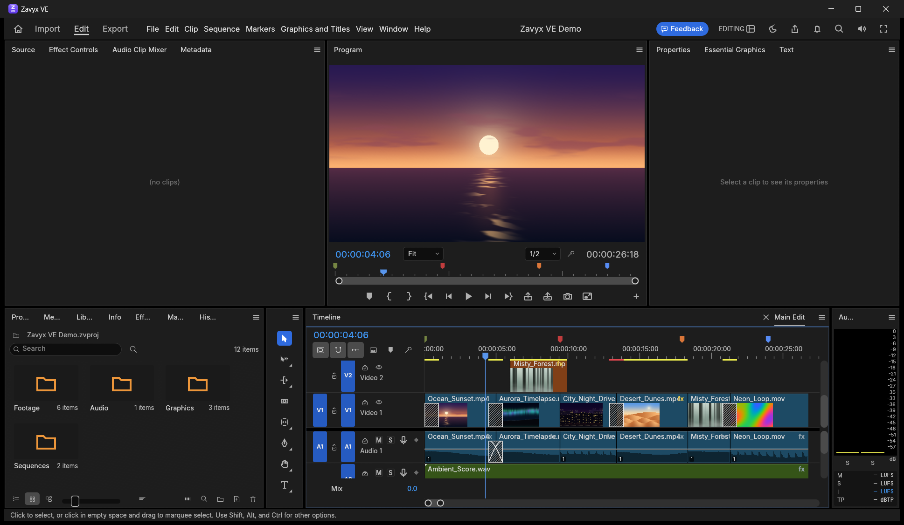

<p align="center">
  
</p>

<h1 align="center">Zavyx Video Editor</h1>

<p align="center"><sub>Zavyx VE · part of the <a href="https://github.com/mohammadibrahimdev/zavyx">Zavyx</a> family of free tools</sub></p>

<p align="center">
  <b>A free, open-source, professional video editor for Windows.</b><br>
  Multi-track timeline · colour grading and scopes · titles and captions · effects and keyframes · audio mixing with loudness meters · export to MP4.
</p>

<p align="center">
  <a href="https://github.com/mohammadibrahimdev/zavyx-video-editor/releases/latest"></a>
  
  
</p>

<p align="center">
  
</p>

---

## ✨ What it does

- **Edit like a pro** — source and program monitors, a multi-track timeline with ripple, roll, slip and slide, markers, nested sequences and multicam.
- **Colour** — grading in 32-bit float linear light, with waveform and vectorscope scopes that show the real graded frame.
- **Titles and captions** — text with fonts, styles and animation; captions you can edit and export.
- **Effects and keyframes** — blur, sharpen, transforms, blend modes and more, animated with keyframes.
- **Sound** — clip and track mixing with loudness meters (EBU R128 / ITU-R BS.1770).
- **Plays your media** — H.264, HEVC, VP9, AV1, ProRes, AAC, Opus and more, with hardware decoding where your PC has it. No FFmpeg needed: the codecs are built in.
- **Export** — H.264 MP4 with AAC, ready for YouTube and social media.
- **Private** — works offline. No account, no watermark, no ads, no tracking.
- **Won't lose your work** — auto-save and crash recovery; a bad file gives an error, not a crash.

## 🪟 Made for Windows

- **32-bit Windows works** — the x86 build runs on the GPU like the 64-bit one (a DirectX 12
  pipeline bug that stopped every 32-bit build from opening is fixed in `zavyx/patches/`).
- **DirectX 12 first** — chosen over Vulkan on Windows, so PCs whose Vulkan driver crashes
  (common on Intel graphics) start normally.
- **GPU effects everywhere** — Microsoft's DirectX shader compiler ships with the app, so effects
  run on the graphics card instead of falling back to the CPU.
- **Falls back by itself** — if the graphics driver fails at start-up, Zavyx VE restarts in a safe
  graphics mode instead of closing.
- **Installs without admin rights** — choose "just for me" in the installer, or use the portable ZIP.

## ⬇ Download

Go to the **[latest release](https://github.com/mohammadibrahimdev/zavyx-video-editor/releases/latest)**:

| Windows | Installer | Portable (no install) |
| --- | --- | --- |
| 64-bit (most PCs) | `zavyx-ve-<version>-windows-x64.msi` | `zavyx-ve-<version>-windows-x64-portable.zip` |
| 32-bit | `zavyx-ve-<version>-windows-x86.msi` | `zavyx-ve-<version>-windows-x86-portable.zip` |

The installer asks whether to install for you only (no admin rights needed) or for everyone.
The portable ZIP runs from any folder and keeps its settings next to `zavyx-ve.exe`.

Needs Windows 10 or 11 and a graphics card with DirectX 12 or Vulkan (almost every PC from the
last ten years). On a PC without one, start it with `zavyx-ve.exe --graphics software`.

Older PC, or no DirectX 12? Try **[Zavyx VE Lite](https://github.com/mohammadibrahimdev/zavyx-video-editor-lite)**:
a smaller editor with the everyday tools (timeline, titles, transitions, effects, export).

> Windows SmartScreen may say the app is from an unknown publisher until it is code-signed.
> Click **More info → Run anyway**.

## 🛠 Build from source

Needs [Rust](https://rustup.rs) (stable, MSVC toolchain on Windows).

```bash
git clone https://github.com/mohammadibrahimdev/zavyx-video-editor.git
cd zavyx-video-editor
cargo run --release -p zavyx-ve
```

The first build takes a while (around 45 minutes on a laptop): every codec is compiled from source.
To build the installer and portable ZIP like a release (needs WiX 5:
`dotnet tool install --global wix --version 5.0.2`):

```bash
pwsh packaging/windows/package.ps1 -Arch x64
```

Releases are built this way for both architectures and uploaded to GitHub. The `Release` workflow
can also build and publish them on GitHub's own machines (slower: 1–2 hours).

### Where things are

| Folder | What it is |
| --- | --- |
| `apps/zavyx-ve` | The desktop app (`zavyx-ve.exe`) |
| `apps/zavyx-ve-cli` | Headless command-line tool (`zavyx-ve-cli.exe`) |
| `crates/` | Engine, timeline, colour, audio, export and every codec, one crate each |
| `packaging/windows` | MSI installer (WiX) and portable ZIP |
| `zavyx/patches` | Fixes to third-party crates (32-bit DirectX 12) |
| `docs/` | Developer docs: architecture, testing, control protocol |

## 👤 Author

Made by **Mohammad Ibrahim**: [github.com/mohammadibrahimdev](https://github.com/mohammadibrahimdev)

## 📄 License

Free and open source under the [MIT](LICENSE-MIT) or [Apache-2.0](LICENSE-APACHE) license, at your
option. Fonts and other third-party material are listed in [NOTICE](NOTICE) and
[ATTRIBUTION.md](ATTRIBUTION.md).

## 🙏 Credits

Zavyx VE is built on [FilmCraft](https://github.com/storytold/filmcraft) by the ArtCraft team,
used under the MIT licence.
